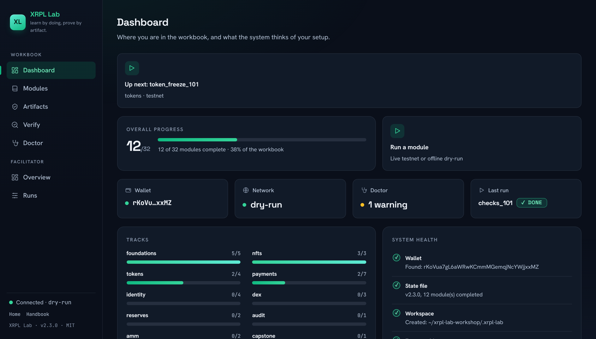
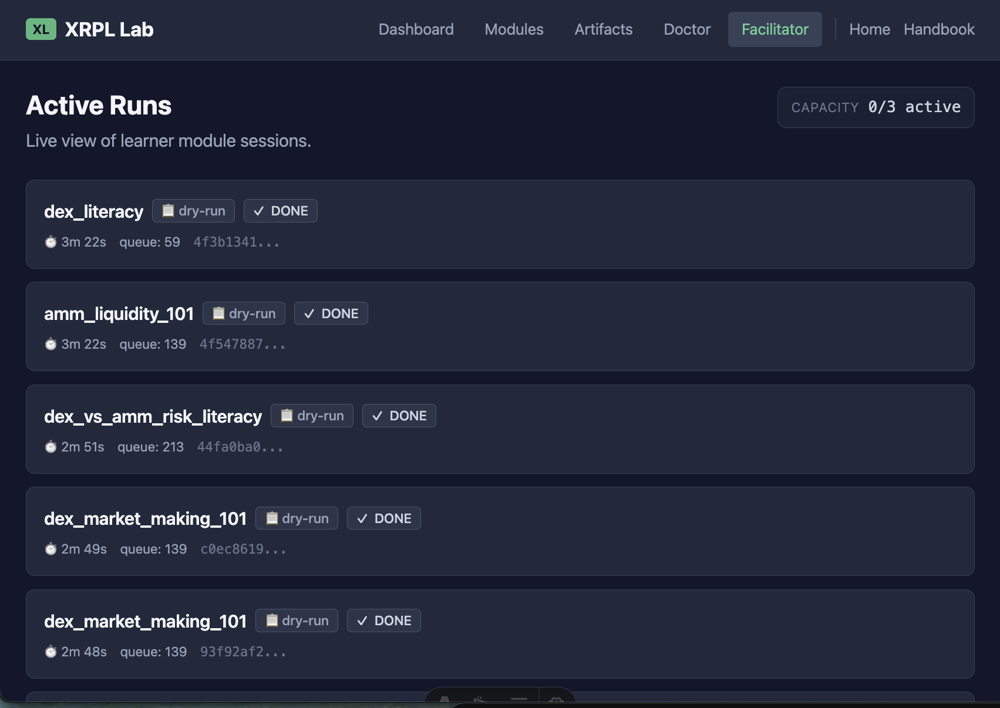

<p align="center">
  <a href="README.ja.md">日本語</a> | <a href="README.zh.md">中文</a> | <a href="README.md">English</a> | <a href="README.fr.md">Français</a> | <a href="README.hi.md">हिन्दी</a> | <a href="README.it.md">Italiano</a> | <a href="README.pt-BR.md">Português (BR)</a>
</p>

<p align="center">
  
</p>

<p align="center">
  <a href="https://github.com/mcp-tool-shop-org/xrpl-lab/actions/workflows/ci.yml"></a>
  <a href="https://pypi.org/project/xrpl-lab/"></a>
  <a href="https://www.npmjs.com/package/@mcptoolshop/xrpl-lab"></a>
  <a href="https://codecov.io/gh/mcp-tool-shop-org/xrpl-lab"></a>
  <a href="https://github.com/mcp-tool-shop-org/xrpl-lab/blob/main/LICENSE"></a>
  <a href="https://mcp-tool-shop-org.github.io/xrpl-lab/"></a>
</p>

Manual de capacitación de XRPL: aprende haciendo, demuestra con resultados.

Cada módulo enseña una habilidad de XRPL y produce un resultado verificable: un ID de transacción,
un recibo firmado o un informe de diagnóstico. Sin cuentas, sin información innecesaria, sin la nube, solo
competencia y comprobantes.

<p align="center">
  
</p>

## Instalar

```bash
pipx install xrpl-lab
```

O con pip:

```bash
pip install xrpl-lab
```

Requiere Python 3.11 o superior.

¿No tiene Python? El wrapper de npm descarga el archivo binario independiente (requiere Node 18+):

```bash
npx @mcptoolshop/xrpl-lab
```

## Guía de inicio rápido

```bash
xrpl-lab start
```

El asistente guiado le guía a través de la configuración de la billetera, la financiación y su primer módulo.

### Modo sin conexión

```bash
xrpl-lab start --dry-run
```

No se requiere red. Transacciones simuladas para aprender el flujo de trabajo.

## Módulos

<!-- BEGIN curriculum:auto readme-intro -->
<!-- generated by scripts/gen_docs.py — do not hand-edit; run the generator -->
32 módulos en diez áreas temáticas: Fundamentos, NFT, Tokens, Pagos, Identidad, DEX, Reservas, Auditoría, AMM y Proyecto Final.
Los requisitos previos se especifican explícitamente; la CLI y el analizador los hacen cumplir.

La columna `#` coincide con el orden que muestra `xrpl-lab list` (orden temático canónico).
<!-- END curriculum:auto readme-intro -->

<!-- BEGIN curriculum:auto readme-table -->
<!-- generated by scripts/gen_docs.py — do not hand-edit; run the generator -->
| # | Módulo | Área temática | Modo | Requisitos previos | Produce |
|---|--------|-------|------|---------------|----------|
| 1 | Conocimiento de recibos | fundamentos | testnet | — | txid, informe |
| 2 | Conocimiento de fallos | fundamentos | testnet | Conocimiento de recibos | txid, informe |
| 3 | Líneas de confianza 101: monedas emitidas como relaciones | fundamentos | testnet | — | txid, informe |
| 4 | Depuración de líneas de confianza | fundamentos | testnet | Líneas de confianza 101: monedas emitidas como relaciones | txid, informe |
| 5 | Tesorería multisig (SignerListSet): control N de M de la billetera Studio | fundamentos | testnet | Conocimiento de recibos | txid, informe |
| 6 | Creación de NFT 101: su primer activo de juego | nfts | testnet | — | txid, informe |
| 7 | Mercado de NFT 101: intercambio de activos con regalías aplicadas | nfts | testnet | — | txid, informe |
| 8 | NFT dinámicos 101: un artículo de juego que sube de nivel | nfts | testnet | — | txid, informe |
| 9 | Emisión de MPT 101: una moneda de juego en una sola transacción | tokens | testnet | — | txid, informe |
| 10 | Distribución de MPT 101: cómo obtener la moneda para los jugadores | tokens | testnet | Emisión de MPT 101: una moneda de juego en una sola transacción | txid, informe |
| 11 | Congelación de tokens 101: el botón de pausa del emisor | tokens | testnet | — | txid, informe |
| 12 | Reembolso 101: la herramienta de revocación del emisor | tokens | testnet | — | txid, informe |
| 13 | Depósito en garantía 101: XRP con tiempo limitado | pagos | testnet | — | txid, informe |
| 14 | Finalización del depósito en garantía 101: liberación del XRP bloqueado | pagos | testnet | Depósito en garantía 101: XRP con tiempo limitado | txid, informe |
| 15 | Depósito en garantía de tokens (XLS-85): bloqueo de IOUs, no solo de XRP | pagos | testnet | Líneas de confianza 101: monedas emitidas como relaciones, depósito en garantía 101: XRP con tiempo limitado | txid, informe |
| 16 | Comprobaciones 101: pagos diferidos (CheckCreate / CheckCash / CheckCancel) | pagos | testnet | Conocimiento de recibos | txid, informe |
| 17 | Canales de pago 101: firme muchos, liquide una vez | pagos | testnet | — | txid, informe |
| 18 | Cantidad entregada: la vulnerabilidad de los pagos parciales | pagos | testnet | Líneas de confianza 101: monedas emitidas como relaciones | txid, informe |
| 19 | Acreditación de jugadores con custodia: una billetera agrupada, muchos jugadores (etiquetas de destino) | pagos | testnet | Cantidad entregada: la vulnerabilidad de los pagos parciales | txid, informe |
| 20 | DID 101: identidad en el libro mayor | identidad | testnet | — | txid, informe |
| 21 | Credenciales 101 (XLS-70): KYC y atestaciones de edad en el libro mayor | identidad | testnet | DID 101: identidad en el libro mayor | txid, informe |
| 22 | Dominios con permisos y DEX con acceso restringido (XLS-80/81): comercio compatible y con acceso restringido por credenciales | identidad | testnet | Credenciales 101 (XLS-70): KYC y atestaciones de edad en el libro mayor | txid, informe |
| 23 | Puerta de depósito (DepositAuth + DepositPreauth): depósitos de tesorería con acceso restringido por credenciales | identidad | testnet | Credenciales 101 (XLS-70): KYC y atestaciones de edad en el libro mayor | txid, informe |
| 24 | Conocimiento de DEX: ofertas, libros de órdenes y cancelaciones | dex | testnet | Líneas de confianza 101: monedas emitidas como relaciones | txid, informe |
| 25 | Creación de mercado DEX 101: obtención de ganancias por la diferencia en el libro de órdenes | dex | testnet | Conocimiento de DEX: ofertas, libros de órdenes y cancelaciones | txid, informe |
| 26 | Protecciones de inventario DEX: no se desequilibre | dex | testnet | Creación de mercado DEX 101: obtención de ganancias por la diferencia en el libro de órdenes | txid, informe |
| 27 | Reservas 101: dónde "fue" su XRP | reservas | testnet | Líneas de confianza 101: monedas emitidas como relaciones | txid, informe |
| 28 | Higiene de la cuenta: liberación de reservas y limpieza de objetos | reservas | testnet | Reservas 101: dónde "fue" su XRP | txid, informe |
| 29 | Modo de auditoría: verificación de recibos a escala | auditoría | testnet | Conocimiento de recibos | informe, paquete de auditoría |
| 30 | Liquidez AMM 101: provisión de liquidez y obtención de comisiones | amm | testnet | Líneas de confianza 101: monedas emitidas como relaciones | txid, informe |
| 31 | Conocimiento de riesgos de DEX frente a AMM: comparación de estrategias de negociación | amm | ejecución de prueba | Creación de mercado DEX 101: obtención de ganancias por la diferencia en el libro de órdenes, liquidez AMM 101: provisión de liquidez y obtención de comisiones | txid, informe |
| 32 | Proyecto final: configure una economía de juego mínima en XRPL | proyecto final | testnet | Emisión de MPT 101: una moneda de juego en una sola transacción, creación de NFT 101: su primer activo de juego, depósito en garantía 101: XRP con tiempo limitado, modo de auditoría: verificación de recibos a escala | txid, informe, paquete de auditoría |
<!-- END curriculum:auto readme-table -->

La columna **Produce** enumera los tipos de resultados que genera cada módulo (`txid`,
`report`, `audit_pack`); consulte la página de cada módulo en el
[manual](https://mcp-tool-shop-org.github.io/xrpl-lab/handbook/modules/) para
obtener la guía completa de habilidades y lo que demuestra en el libro mayor.

### Áreas temáticas

<!-- BEGIN curriculum:auto readme-tracks -->
<!-- generated by scripts/gen_docs.py — do not hand-edit; run the generator -->
- **fundamentos**: billetera, pagos, líneas de confianza, manejo de errores
- **nfts**: activos de juego NFT: creación, liquidación del mercado (XLS-20), NFT dinámicos (XLS-46)
- **tokens**: emisión y distribución de MPT (XLS-33), congelación de tokens, reembolso (XLS-39)
- **pagos**: depósito en garantía con tiempo limitado, comprobaciones, canales de pago, pagos parciales, etiquetas de destino
- **identidad**: DID (XLS-40), credenciales (XLS-70), DEX con permisos (XLS-80/81), autenticación de depósito
- **dex**: ofertas, libros de órdenes, creación de mercado, gestión de inventario
- **reservas**: reservas de cuenta, recuento de propietarios, limpieza
- **auditoría**: verificación por lotes, informes de auditoría
- **amm**: liquidez del creador de mercado automatizado, comparación de DEX y AMM
- **proyecto final**: combine las habilidades de las áreas temáticas en una sola construcción de economía de juego
<!-- END curriculum:auto readme-tracks -->

### Modos

- **testnet**: transacciones reales en la red de prueba XRPL
- **ejecución de prueba**: entorno de pruebas sin conexión con transacciones simuladas (no se requiere red)

## Comandos

```text
xrpl-lab start              Guided launcher
xrpl-lab list               Show all modules with status and progression
xrpl-lab run <module_id>    Run a specific module
xrpl-lab status [--json]    Progress, curriculum position, blockers, track progress
xrpl-lab cohort-status [--dir DIR] [--format FORMAT]  Aggregate per-learner status across a cohort directory (facilitator)
xrpl-lab session-export [--dir DIR] [--format FORMAT] [--outfile FILE]  Archive all learner artifacts with a SHA-256 manifest
xrpl-lab tracks             Track-level completion summaries
xrpl-lab recovery           Diagnose stuck states, show recovery commands
xrpl-lab lint [glob] [--json] [--no-curriculum]  Validate module files and curriculum
xrpl-lab proof-pack         Export shareable proof pack
xrpl-lab verify-artifact <file> [--json] [--live]  Verify any artifact (proof packs, certificates, audit packs, support bundles); --live also checks a proof pack's or certificate's transactions on the ledger
xrpl-lab certificate        Export completion certificate
xrpl-lab doctor             Run diagnostic checks
xrpl-lab support-bundle [--json]  Generate a support bundle
xrpl-lab audit              Batch verify transactions
xrpl-lab last-run           Show last module run + audit command
xrpl-lab serve [--port N] [--host H] [--dry-run]  Start web dashboard and API server
xrpl-lab reset [--module MODULE_ID]  Wipe local state OR reset a single module (requires confirmation)
xrpl-lab module init --id ID --track TRACK --title TITLE --time TIME  Scaffold a lint-passing module skeleton
xrpl-lab curriculum manifest  Print the curriculum manifest the docs are generated from

xrpl-lab wallet create      Create a new wallet
xrpl-lab wallet show        Show wallet info (no secrets)
xrpl-lab fund               Fund wallet from testnet faucet
xrpl-lab send --to <address> --amount <xrp> [--memo <text>]  Send a payment
xrpl-lab verify --tx <id>   Verify a transaction on-ledger
```

Todos los comandos admiten `--dry-run` para el modo sin conexión cuando corresponda.

## Uso en talleres

XRPL Lab está diseñado para entornos de enseñanza reales. Sin cuentas, sin telemetría, sin la nube.
Todo se ejecuta localmente.

<p align="center">
  
</p>

### Estado del facilitador

```bash
xrpl-lab status             # Where is this learner? What's blocked? What's next?
xrpl-lab status --json      # Machine-readable for scripting
xrpl-lab tracks             # Track-level completion: what was actually practiced
xrpl-lab recovery           # Stuck? See exactly what to run next
```

### Transferencia de soporte

```bash
xrpl-lab support-bundle              # Human-readable markdown bundle
xrpl-lab support-bundle --json       # Machine-parseable JSON
xrpl-lab verify-artifact bundle.json    # Verify a received bundle
```

Un facilitador puede diagnosticar el problema de cualquier alumno a partir de un paquete de soporte sin
reproducir toda la sesión. No se incluyen secretos.

### Flujos de trabajo

**Entorno de pruebas completamente desconectado**: no se requiere red.
```bash
xrpl-lab wallet create
xrpl-lab start --dry-run
```

**Mixto: modo sin conexión + red de prueba:** transacciones reales para los conceptos básicos, entorno de pruebas para funciones avanzadas:
```bash
xrpl-lab wallet create
xrpl-lab fund
xrpl-lab start
```

**Progresión de Camp → Lab:** continuar desde xrpl-camp:
```bash
xrpl-lab start    # auto-detects camp wallet and certificate
```

## Artefactos

**Paquete de prueba** (`xrpl_lab_proof_pack.json`): registro compartible de los módulos completados,
identificadores de transacción y enlaces al explorador. Incluye un hash de integridad SHA-256. No contiene información confidencial.

**Certificado** (`xrpl_lab_certificate.json`): registro conciso de la finalización.

**Informes** (`reports/*.md`): resúmenes legibles por humanos de lo que hizo y demostró.

**Paquetes de auditoría** (`audit_pack_*.json`): resultados de verificación por lotes con un hash de integridad SHA-256.

## Cuando se restablece una red de prueba

A veces, la red de prueba y la red de desarrollo se restablecen, lo que elimina todas las cuentas y
transacciones que contienen. **Ambas se restablecen el 25 de noviembre de 2026**
([aviso de xrpl.org](https://xrpl.org/blog/2026/testnet-devnet-reset)).

**Su propio laboratorio.** Su archivo de billetera, su dirección, su progreso y sus informes
se guardan. Su cuenta en la red desaparece, al igual que los resultados en el libro mayor
de los módulos que completó antes del restablecimiento.

```bash
xrpl-lab doctor                       # "Network reset" warns when this applies to you
xrpl-lab recovery                     # lists the steps for your case
xrpl-lab fund                         # fund the same address again
xrpl-lab run <module_id> --force      # prove a module on the new ledger
xrpl-lab proof-pack                   # export a pack that verifies again
```

**Un paquete de prueba de antes de un restablecimiento.** Su hash sigue siendo válido en modo sin conexión. Con
`--live`, sus transacciones ya no se pueden encontrar, y `verify-artifact` indica
por qué, con su propio código de salida:

| Salida | Resultado | Significado |
|------|---------|---------|
| `0` | PASADO | El hash está intacto y todas las transacciones se confirmaron en el libro mayor. |
| `1` | FALLIDO | La verificación del hash falló, o falta una transacción o no es como se afirmó. |
| `4` | RESTABLECIDO o NO CONFIRMADO | No se encontró nada incorrecto, pero no se pueden verificar las transacciones. |

Con la salida `4`, la salida y `--json` (`reset_signal`) indican en qué se basa el resultado:

| `reset_signal` | Se basa en | Estado |
|----------------|----------|--------|
| `announced` | Un restablecimiento anunciado y listado cubre el período en el que se registró la transacción. | `RESET` |
| `seen_by_this_lab` | El laboratorio que ejecuta la verificación detectó el restablecimiento en su propio estado. | `RESET` |
| `pack_claim` | Solo el paquete en sí indica que hubo un restablecimiento. | `UNCONFIRMED` |

Ni `RESET` ni `UNCONFIRMED` son un resultado positivo. Un paquete que enumera transacciones inventadas con fecha anterior a un restablecimiento se lee de la misma manera que uno honesto, por lo que solo
el hash sin conexión queda como evidencia, y un hash muestra que el archivo no se ha modificado, no que las transacciones ocurrieron. Para obtener un paquete que se verifique
de nuevo en el libro mayor, vuelva a ejecutar los módulos después del restablecimiento y exporte un nuevo paquete. El
[manual](https://mcp-tool-shop-org.github.io/xrpl-lab/handbook/commands/)
contiene los detalles.

## Modelo de seguridad y confianza

**Datos a los que accede XRPL Lab:**
- Semilla de la billetera (almacenada localmente en `~/.xrpl-lab/wallet.json` como JSON en texto plano: modo POSIX `0o600` / `0o700`, o una ACL de solo propietario en Windows; no está cifrada)
- Progreso del módulo e identificadores de transacción (almacenados en `~/.xrpl-lab/state.json`, escrituras atómicas mediante tmp + rename)
- XRPL Testnet RPC (punto final público, las transacciones se firman localmente antes del envío)
- Grifo de la red de prueba (HTTP público, solo se envía su dirección)

**Datos a los que XRPL Lab NO accede:**
- No a la red principal. Solo a la red de prueba.
- No hay telemetría, análisis ni comunicación con el hogar de ningún tipo.
- No hay cuentas en la nube, ni registro, ni API de terceros.
- No hay información confidencial en los paquetes de prueba, certificados, informes o paquetes de soporte, nunca.

**Permisos y niveles de almacenamiento:**
- Directorio de inicio `~/.xrpl-lab/`: nivel de secretos privados (POSIX `0o700` / `0o600`, o una ACL de solo propietario en Windows). Almacena la semilla de la billetera, el registro del médico, los paquetes de auditoría.
- Espacio de trabajo `./.xrpl-lab/`: nivel diseñado para compartir, directorio 0o755. Almacena los informes de los módulos, los paquetes de prueba, los certificados. Los facilitadores pueden revisarlos sin necesidad de elevar los permisos.
- Sistema de archivos: solo lee y escribe en las dos ubicaciones anteriores.
- Red: solo XRPL Testnet RPC + grifo (ambos se pueden anular mediante variables de entorno, ambos son opcionales con `--dry-run`).
- No se requieren permisos elevados.

**Superficie del panel (cuando `xrpl-lab serve` está en ejecución):**
- El punto final del ejecutor WebSocket aplica una lista de permitidos de origen (cierra las conexiones que no están en la lista con el código 4003).
- Las solicitudes HTTP que cambian el estado (POST, PUT, PATCH, DELETE) desde un origen que no está en la lista se rechazan con `403 ORIGIN_REJECTED`, por lo que una página en otra pestaña no puede iniciar una ejecución; las solicitudes sin origen (CLI, curl) siguen funcionando.
- Las solicitudes cuyo `Host` no es loopback o la dirección `serve` a la que está enlazado se rechazan con `400 HOST_REJECTED`, lo que cierra el enlace DNS (desactivado para un enlace `0.0.0.0`).
- Todos los marcos de error emiten un sobre estructurado (`code`, `message`, `hint`, `severity`, `icon_hint`): no hay fugas de ruta, no hay fugas de estado interno.
- Cola de mensajes por conexión limitada con un comportamiento de contrapresión documentado.

Consulte [SECURITY.md](SECURITY.md) para obtener la política de seguridad completa y la guía de configuración del taller.

## Requisitos

- Python 3.11+
- Conexión a Internet para la red de prueba (o utilice `--dry-run` para un modo completamente sin conexión)

## Licencia

MIT

Creado por [MCP Tool Shop](https://mcp-tool-shop.github.io/)
