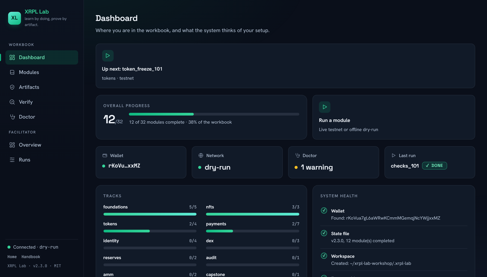
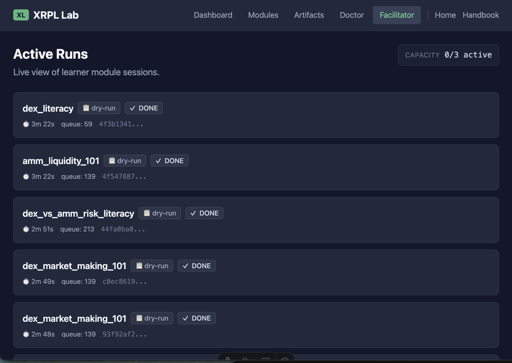

<p align="center">
  <a href="README.md">English</a> | <a href="README.zh.md">中文</a> | <a href="README.es.md">Español</a> | <a href="README.fr.md">Français</a> | <a href="README.hi.md">हिन्दी</a> | <a href="README.it.md">Italiano</a> | <a href="README.pt-BR.md">Português (BR)</a>
</p>

<p align="center">
  
</p>

<p align="center">
  <a href="https://github.com/mcp-tool-shop-org/xrpl-lab/actions/workflows/ci.yml"></a>
  <a href="https://pypi.org/project/xrpl-lab/"></a>
  <a href="https://www.npmjs.com/package/@mcptoolshop/xrpl-lab"></a>
  <a href="https://codecov.io/gh/mcp-tool-shop-org/xrpl-lab"></a>
  <a href="https://github.com/mcp-tool-shop-org/xrpl-lab/blob/main/LICENSE"></a>
  <a href="https://mcp-tool-shop-org.github.io/xrpl-lab/"></a>
</p>

XRPLトレーニングワークブック — 実際に手を動かしながら学習し、成果物で理解を深めます。

各モジュールでは、1つのXRPLスキルを教え、検証可能な成果物（トランザクションID、署名されたレシート、または診断レポート）を作成します。アカウントは不要で、無駄な機能やクラウドも使用しません。必要なのは、スキルとレシートだけです。

<p align="center">
  
</p>

## インストール

```bash
pipx install xrpl-lab
```

または、pipを使用して：

```bash
pip install xrpl-lab
```

Python 3.11以上が必要です。

Pythonがインストールされていない場合：npmラッパーがスタンドアロンバイナリをダウンロードします（Node 18以上が必要です）。

```bash
npx @mcptoolshop/xrpl-lab
```

## クイックスタート

```bash
xrpl-lab start
```

ガイド付きランチャーが、ウォレットの設定、資金調達、最初のモジュールの実行をステップごとに案内します。

### オフラインモード

```bash
xrpl-lab start --dry-run
```

ネットワークは不要です。ワークフローの学習のために、シミュレートされたトランザクションを使用します。

## モジュール

<!-- BEGIN curriculum:auto readme-intro -->
<!-- generated by scripts/gen_docs.py — do not hand-edit; run the generator -->
10のトラックにわたる32のモジュール：基礎、NFT、トークン、支払い、ID、DEX、リザーブ、監査、AMM、および集大成。
前提条件は明確に示されており、CLIとリンターによって強制されます。

`#`列は、`xrpl-lab list`（標準のトラック順）で表示される順序と一致します。
<!-- END curriculum:auto readme-intro -->

<!-- BEGIN curriculum:auto readme-table -->
<!-- generated by scripts/gen_docs.py — do not hand-edit; run the generator -->
| # | モジュール | トラック | モード | 前提条件 | 生成される成果物 |
|---|--------|-------|------|---------------|----------|
| 1 | レシートの読み取り | 基礎 | テストネット | — | txid、レポート |
| 2 | エラーへの対処 | 基礎 | テストネット | レシートの読み取り | txid、レポート |
| 3 | トラストライン101：発行通貨を関係性として | 基礎 | テストネット | — | txid、レポート |
| 4 | トラストラインのデバッグ | 基礎 | テストネット | トラストライン101：発行通貨を関係性として | txid、レポート |
| 5 | マルチシグ宝庫（SignerListSet）：スタジオウォレットのN-of-M制御 | 基礎 | テストネット | レシートの読み取り | txid、レポート |
| 6 | NFTミント101：最初のゲームアセット | nft | テストネット | — | txid、レポート |
| 7 | NFTマーケットプレイス101：ロイヤリティが適用されたアセットの取引 | nft | テストネット | — | txid、レポート |
| 8 | 動的NFT101：レベルアップするゲームアイテム | nft | テストネット | — | txid、レポート |
| 9 | MPT発行101：1つのトランザクションでゲーム通貨を発行 | トークン | テストネット | — | txid、レポート |
| 10 | MPT配布101：通貨をプレイヤーに配布 | トークン | テストネット | MPT発行101：1つのトランザクションでゲーム通貨を発行 | txid、レポート |
| 11 | トークンフリーズ101：発行者のポーズボタン | トークン | テストネット | — | txid、レポート |
| 12 | クローバック101：発行者のリコールレバー | トークン | テストネット | — | txid、レポート |
| 13 | エスクロー101：時間制限付きのXRP | 支払い | テストネット | — | txid、レポート |
| 14 | エスクロー完了101：ロックされたXRPを解放 | 支払い | テストネット | エスクロー101：時間制限付きのXRP | txid、レポート |
| 15 | トークンエスクロー（XLS-85）：IOUをロックし、XRPだけでなく | 支払い | テストネット | トラストライン101：発行通貨を関係性として、エスクロー101：時間制限付きのXRP | txid、レポート |
| 16 | チェック101：遅延支払い（CheckCreate / CheckCash / CheckCancel） | 支払い | テストネット | レシートの読み取り | txid、レポート |
| 17 | 支払いチャネル101：署名を複数行い、1回で決済 | 支払い | テストネット | — | txid、レポート |
| 18 | 配信額：部分支払いによる脆弱性 | 支払い | テストネット | トラストライン101：発行通貨を関係性として | txid、レポート |
| 19 | カストディアルプレイヤーへのクレジット：1つのプールされたウォレット、複数のプレイヤー（宛先タグ） | 支払い | テストネット | 配信額：部分支払いによる脆弱性 | txid、レポート |
| 20 | DID101：オンチェーンID | ID | テストネット | — | txid、レポート |
| 21 | 資格情報101（XLS-70）：オンチェーンKYCおよび年齢認証 | ID | テストネット | DID101：オンチェーンID | txid、レポート |
| 22 | 許可されたドメインとゲート付きDEX（XLS-80/81）：コンプライアンスに準拠し、資格情報によってアクセスが制限された取引 | ID | テストネット | 資格情報101（XLS-70）：オンチェーンKYCおよび年齢認証 | txid、レポート |
| 23 | デポジットゲート（DepositAuth + DepositPreauth）：資格情報によってアクセスが制限された宝庫へのデポジット | ID | テストネット | 資格情報101（XLS-70）：オンチェーンKYCおよび年齢認証 | txid、レポート |
| 24 | DEXの理解：オファー、オーダーブック、キャンセル | dex | テストネット | トラストライン101：発行通貨を関係性として | txid、レポート |
| 25 | DEXマーケットメイキング101：オーダーブックでスプレッドを稼ぐ | dex | テストネット | DEXの理解：オファー、オーダーブック、キャンセル | txid、レポート |
| 26 | DEXインベントリの安全策：偏った状態にならないようにする | dex | テストネット | DEXマーケットメイキング101：オーダーブックでスプレッドを稼ぐ | txid、レポート |
| 27 | リザーブ101：XRPが「どこへ行った」のか | リザーブ | テストネット | トラストライン101：発行通貨を関係性として | txid、レポート |
| 28 | アカウントの衛生管理：リザーブを解放し、オブジェクトをクリーンアップする | リザーブ | テストネット | リザーブ101：XRPが「どこへ行った」のか | txid、レポート |
| 29 | 監査モード：大規模にレシートを検証 | 監査 | テストネット | レシートの読み取り | レポート、監査パック |
| 30 | AMM流動性101：流動性を提供し、手数料を稼ぐ | amm | テストネット | トラストライン101：発行通貨を関係性として | txid、レポート |
| 31 | DEXとAMMのリスクに関する理解：取引戦略を比較 | amm | ドライラン | DEXマーケットメイキング101：オーダーブックでスプレッドを稼ぐ、AMM流動性101：流動性を提供し、手数料を稼ぐ | txid、レポート |
| 32 | 集大成：XRPL上に最小限のゲームエコノミーを構築 | 集大成 | テストネット | MPT発行101：1つのトランザクションでゲーム通貨を発行、NFTミント101：最初のゲームアセット、エスクロー101：時間制限付きのXRP、監査モード：大規模にレシートを検証 | txid、レポート、監査パック |
<!-- END curriculum:auto readme-table -->

「生成される成果物」列には、各モジュールが生成する成果物の種類がリストされています（`txid`、`report`、`audit_pack`）。各モジュールのページにある[ハンドブック](https://mcp-tool-shop-org.github.io/xrpl-lab/handbook/modules/)を参照して、完全なスキルの概要と、オンチェーンで何を証明するかを確認してください。

### トラック

<!-- BEGIN curriculum:auto readme-tracks -->
<!-- generated by scripts/gen_docs.py — do not hand-edit; run the generator -->
- **基礎** — ウォレット、支払い、トラストライン、エラー処理
- **NFT** — NFTゲームアセット：ミント、マーケットプレイス決済（XLS-20）、動的NFT（XLS-46）
- **トークン** — MPT発行と配布（XLS-33）、トークンフリーズ、クローバック（XLS-39）
- **支払い** — 時間制限付きエスクロー、チェック、支払いチャネル、部分支払い、宛先タグ
- **ID** — DID（XLS-40）、資格情報（XLS-70）、許可されたDEX（XLS-80/81）、デポジット認証
- **DEX** — オファー、オーダーブック、マーケットメイキング、インベントリ管理
- **リザーブ** — アカウントリザーブ、所有者数、クリーンアップ
- **監査** — バッチ検証、監査レポート
- **AMM** — 自動マーケットメーカー流動性、DEXとAMMの比較
- **集大成** — トラック間でスキルを組み合わせて、1つのゲームエコノミーを構築
<!-- END curriculum:auto readme-tracks -->

### モード

- **テストネット** — XRPLテストネット上の実際のトランザクション
- **ドライラン** — オフラインサンドボックスでシミュレートされたトランザクションを使用（ネットワークは不要）

## コマンド

```text
xrpl-lab start              Guided launcher
xrpl-lab list               Show all modules with status and progression
xrpl-lab run <module_id>    Run a specific module
xrpl-lab status [--json]    Progress, curriculum position, blockers, track progress
xrpl-lab cohort-status [--dir DIR] [--format FORMAT]  Aggregate per-learner status across a cohort directory (facilitator)
xrpl-lab session-export [--dir DIR] [--format FORMAT] [--outfile FILE]  Archive all learner artifacts with a SHA-256 manifest
xrpl-lab tracks             Track-level completion summaries
xrpl-lab recovery           Diagnose stuck states, show recovery commands
xrpl-lab lint [glob] [--json] [--no-curriculum]  Validate module files and curriculum
xrpl-lab proof-pack         Export shareable proof pack
xrpl-lab verify-artifact <file> [--json] [--live]  Verify any artifact (proof packs, certificates, audit packs, support bundles); --live also checks a proof pack's or certificate's transactions on the ledger
xrpl-lab certificate        Export completion certificate
xrpl-lab doctor             Run diagnostic checks
xrpl-lab support-bundle [--json]  Generate a support bundle
xrpl-lab audit              Batch verify transactions
xrpl-lab last-run           Show last module run + audit command
xrpl-lab serve [--port N] [--host H] [--dry-run]  Start web dashboard and API server
xrpl-lab reset [--module MODULE_ID]  Wipe local state OR reset a single module (requires confirmation)
xrpl-lab module init --id ID --track TRACK --title TITLE --time TIME  Scaffold a lint-passing module skeleton
xrpl-lab curriculum manifest  Print the curriculum manifest the docs are generated from

xrpl-lab wallet create      Create a new wallet
xrpl-lab wallet show        Show wallet info (no secrets)
xrpl-lab fund               Fund wallet from testnet faucet
xrpl-lab send --to <address> --amount <xrp> [--memo <text>]  Send a payment
xrpl-lab verify --tx <id>   Verify a transaction on-ledger
```

すべてのコマンドは、適用可能な場合は、オフラインモードの`--dry-run`をサポートします。

## ワークショップでの使用

XRPL Labは、実際の教育環境向けに設計されています。アカウント、テレメトリ、クラウドは不要です。すべてローカルで実行されます。

<p align="center">
  
</p>

### ファシリテーターのステータス

```bash
xrpl-lab status             # Where is this learner? What's blocked? What's next?
xrpl-lab status --json      # Machine-readable for scripting
xrpl-lab tracks             # Track-level completion: what was actually practiced
xrpl-lab recovery           # Stuck? See exactly what to run next
```

### サポートの引き継ぎ

```bash
xrpl-lab support-bundle              # Human-readable markdown bundle
xrpl-lab support-bundle --json       # Machine-parseable JSON
xrpl-lab verify-artifact bundle.json    # Verify a received bundle
```

ファシリテーターは、サポートバンドルから学習者の問題を再現することなく診断できます。秘密情報は含まれません。

### ワークショップの流れ

**完全にオフラインのサンドボックス** — ネットワークは不要です。
```bash
xrpl-lab wallet create
xrpl-lab start --dry-run
```

**オフライン環境とテストネットの組み合わせ** — 基本的な操作には実際のトランザクションを、高度な操作にはサンドボックスを使用します。
```bash
xrpl-lab wallet create
xrpl-lab fund
xrpl-lab start
```

**キャンプからラボへの移行** — xrpl-campから続行します。
```bash
xrpl-lab start    # auto-detects camp wallet and certificate
```

## 成果物

**証明パック**（`xrpl_lab_proof_pack.json`）：完了したモジュール、トランザクションID、およびエクスプローラーへのリンクを共有できる記録。整合性ハッシュ（SHA-256）が含まれます。秘密情報は含まれません。

**証明書**（`xrpl_lab_certificate.json`）：簡潔な完了記録。

**レポート**（`reports/*.md`）：実行した内容と証明した内容を人間が読める形式でまとめたもの。

**監査パック**（`audit_pack_*.json`）：整合性ハッシュ（SHA-256）を含む、一括検証結果。

## テストネットワークがリセットされた場合

テストネットと開発ネットは、時々リセットされ、その結果、すべての口座とトランザクションが削除されます。**両方とも2026年11月25日にリセットされます**（[xrpl.orgの告知](https://xrpl.org/blog/2026/testnet-devnet-reset)）。

**あなた自身のラボ。** あなたのウォレットファイル、そのアドレス、あなたの進捗状況、およびあなたのレポートは保存されます。ネットワーク上のあなたの口座は消え、リセット前に完了したモジュールのオンチェーンの結果も消えます。

```bash
xrpl-lab doctor                       # "Network reset" warns when this applies to you
xrpl-lab recovery                     # lists the steps for your case
xrpl-lab fund                         # fund the same address again
xrpl-lab run <module_id> --force      # prove a module on the new ledger
xrpl-lab proof-pack                   # export a pack that verifies again
```

**リセット前の証明パック。** そのハッシュはオフラインでも引き続き検証可能です。`--live`を使用すると、トランザクションはそれ以上見つけることができなくなり、`verify-artifact`はその理由と、独自の終了コードを示します。

| 終了 | 結果 | 意味 |
|------|---------|---------|
| `0` | PASS（合格） | ハッシュは整合性が保たれており、すべてのトランザクションが台帳で確認されました。 |
| `1` | FAIL（不合格） | ハッシュのチェックに失敗しました。または、トランザクションが欠落しているか、主張どおりではありません。 |
| `4` | RESET（リセット）またはUNCONFIRMED（未確認） | 誤りが見つかりませんでしたが、トランザクションをチェックできません。 |

終了コード`4`を使用すると、出力と`--json`（`reset_signal`）が、結果が何に基づいているかを示します。

| `reset_signal` | 根拠 | ステータス |
|----------------|----------|--------|
| `announced` | リストに掲載され、告知されたリセットは、トランザクションが記録された時間を網羅します。 | `RESET` |
| `seen_by_this_lab` | チェックを実行しているラボは、自身の状態においてリセットを検知しました。 | `RESET` |
| `pack_claim` | リセットが行われたことを示すのは、パック自体だけです。 | `UNCONFIRMED` |

`RESET`または`UNCONFIRMED`のいずれも合格ではありません。リセット前に作成された架空のトランザクションをリストしたパックは、正直なパックと同じように表示されます。したがって、証拠として残るのはオフラインのハッシュだけであり、ハッシュはファイルが編集されていないことを示しますが、トランザクションが発生したことを示すものではありません。オンチェーンで再度検証できるパックを取得するには、リセット後にモジュールを再実行し、新しいパックをエクスポートします。詳細は[ハンドブック](https://mcp-tool-shop-org.github.io/xrpl-lab/handbook/commands/)を参照してください。

## セキュリティと信頼モデル

**XRPL Labがアクセスするデータ：**
- ウォレットシード（`~/.xrpl-lab/wallet.json`にプレーンテキストJSONとしてローカルに保存。POSIXモード`0o600`/`0o700`の親ディレクトリ、またはWindowsでは所有者のみがアクセスできるACL。暗号化はされません）
- モジュールの進捗状況とトランザクションID（`~/.xrpl-lab/state.json`に保存。tmp + renameによるアトミック書き込み）
- XRPLテストネットRPC（パブリックエンドポイント。トランザクションは送信前にローカルで署名されます）
- テストネットのFaucet（パブリックHTTP。あなたの住所のみが送信されます）

**XRPL Labがアクセスしないデータ：**
- メインネットは使用しません。テストネットのみです。
- テレメトリ、分析、またはあらゆる種類の「ホームへの送信」は行いません。
- クラウドアカウント、登録、またはサードパーティAPIは使用しません。
- 証明パック、証明書、レポート、またはサポートバンドルに秘密情報は一切含めません。

**権限とストレージ階層：**
- ホームディレクトリ`~/.xrpl-lab/` — 秘密情報のプライベート階層（POSIX `0o700`/`0o600`、またはWindowsでは所有者のみがアクセスできるACL）。ウォレットシード、ドクターログ、監査パックを保存します。
- ワークスペースディレクトリ`./.xrpl-lab/` — 設計上、共有可能な階層、0o755ディレクトリ。モジュールのレポート、証明パック、証明書を保存します。ファシリテーターは、権限を昇格させなくてもレビューできます。
- ファイルシステム：上記の2つの場所のみを読み書きします。
- ネットワーク：XRPLテストネットRPC + faucetのみ（両方とも環境変数でオーバーライド可能、両方ともオプションで`--dry-run`を使用）。
- 昇格された権限は必要ありません。

**ダッシュボードの表示（`xrpl-lab serve`が実行されている場合）：**
- WebSocketランナーエンドポイントは、許可リストを適用します（許可リストにない接続は、コード4003で閉じます）。
- 許可リストにないオリジンからの、状態を変更するHTTPリクエスト（POST、PUT、PATCH、DELETE）は、`403 ORIGIN_REJECTED`で拒否されます。そのため、別のタブのページから実行を開始することはできません。オリジンがないリクエスト（CLI、curl）は引き続き機能します。
- `Host`がループバックアドレスまたはアドレス`serve`にバインドされている場合、リクエストは`400 HOST_REJECTED`で拒否され、DNSリバインディングが閉じます（`0.0.0.0`にバインドされている場合はオフ）。
- すべてのエラーフレームは、構造化されたエンベロープを送信します（`code`、`message`、`hint`、`severity`、`icon_hint`）。パスの漏洩や内部状態の漏洩はありません。
- 接続ごとにメッセージキューが制限され、ドキュメント化されたバックプレッシャーの動作があります。

完全なセキュリティポリシーとワークショップのセットアップガイダンスについては、[SECURITY.md](SECURITY.md)を参照してください。

## 要件

- Python 3.11+
- テストネット用のインターネット接続（または、完全にオフラインモードで使用する場合は`--dry-run`を使用します）。

## ライセンス

MIT

[MCP Tool Shop](https://mcp-tool-shop.github.io/)によって作成されました。
