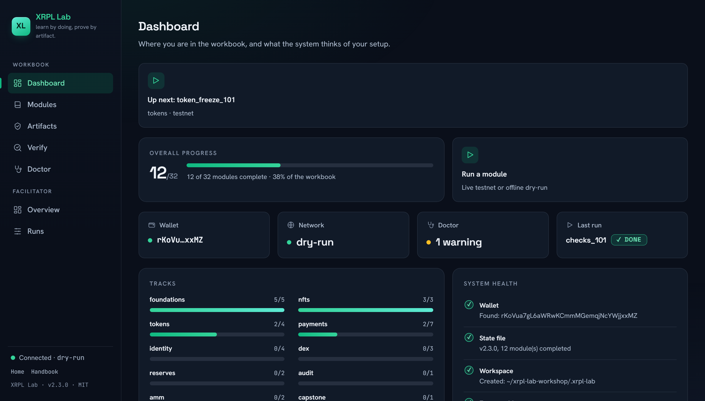
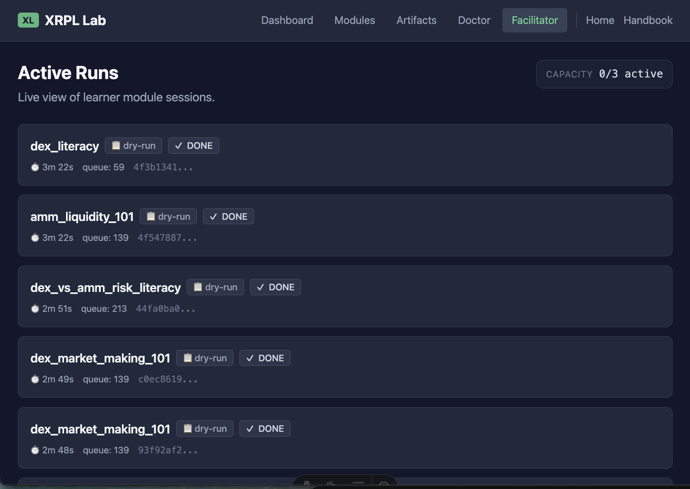

<p align="center">
  <a href="README.ja.md">日本語</a> | <a href="README.md">English</a> | <a href="README.es.md">Español</a> | <a href="README.fr.md">Français</a> | <a href="README.hi.md">हिन्दी</a> | <a href="README.it.md">Italiano</a> | <a href="README.pt-BR.md">Português (BR)</a>
</p>

<p align="center">
  
</p>

<p align="center">
  <a href="https://github.com/mcp-tool-shop-org/xrpl-lab/actions/workflows/ci.yml"></a>
  <a href="https://pypi.org/project/xrpl-lab/"></a>
  <a href="https://www.npmjs.com/package/@mcptoolshop/xrpl-lab"></a>
  <a href="https://codecov.io/gh/mcp-tool-shop-org/xrpl-lab"></a>
  <a href="https://github.com/mcp-tool-shop-org/xrpl-lab/blob/main/LICENSE"></a>
  <a href="https://mcp-tool-shop-org.github.io/xrpl-lab/"></a>
</p>

XRPL 培训手册——通过实践学习，通过成果证明。

每个模块教授一项 XRPL 技能，并生成一个可验证的成果：交易 ID、已签名的收据或诊断报告。无需账户、无需冗余信息、无需云服务——只需掌握技能并获得收据。

<p align="center">
  
</p>

## 安装

```bash
pipx install xrpl-lab
```

或者使用 pip：

```bash
pip install xrpl-lab
```

需要 Python 3.11 或更高版本。

没有 Python？npm 包装器会下载独立的二进制文件（需要 Node 18 或更高版本）：

```bash
npx @mcptoolshop/xrpl-lab
```

## 快速入门

```bash
xrpl-lab start
```

引导式启动器将引导您完成钱包设置、资金充值和第一个模块。

### 离线模式

```bash
xrpl-lab start --dry-run
```

无需网络。模拟交易用于学习工作流程。

## 模块

<!-- BEGIN curriculum:auto readme-intro -->
<!-- generated by scripts/gen_docs.py — do not hand-edit; run the generator -->
共有 32 个模块，分为 10 个主题：基础知识、NFT、令牌、支付、身份、去中心化交易所 (DEX)、储备金、审计、自动做市商 (AMM) 和综合项目。
先决条件明确——命令行界面 (CLI) 和代码检查器 (linter) 会强制执行这些条件。

`#` 列与 `xrpl-lab list` 显示的顺序相匹配（标准主题顺序）。
<!-- END curriculum:auto readme-intro -->

<!-- BEGIN curriculum:auto readme-table -->
<!-- generated by scripts/gen_docs.py — do not hand-edit; run the generator -->
| # | 模块 | 主题 | 模式 | 先决条件 | 生成内容 |
|---|--------|-------|------|---------------|----------|
| 1 | 收据解读 | 基础知识 | 测试网络 | — | txid、报告 |
| 2 | 失败解读 | 基础知识 | 测试网络 | 收据解读 | txid、报告 |
| 3 | 信任线 101：已发行货币作为关系 | 基础知识 | 测试网络 | — | txid、报告 |
| 4 | 调试信任线 | 基础知识 | 测试网络 | 信任线 101：已发行货币作为关系 | txid、报告 |
| 5 | 多重签名金库（SignerListSet）：对工作室钱包进行 N-of-M 控制 | 基础知识 | 测试网络 | 收据解读 | txid、报告 |
| 6 | NFT 铸造 101：您的第一个游戏资产 | NFT | 测试网络 | — | txid、报告 |
| 7 | NFT 市场 101：交易具有强制版税的资产 | NFT | 测试网络 | — | txid、报告 |
| 8 | 动态 NFT 101：一个可以升级的游戏物品 | NFT | 测试网络 | — | txid、报告 |
| 9 | MPT 发行 101：一次交易中的游戏货币 | 令牌 | 测试网络 | — | txid、报告 |
| 10 | MPT 分发 101：将货币分发给玩家 | 令牌 | 测试网络 | MPT 发行 101：一次交易中的游戏货币 | txid、报告 |
| 11 | 令牌冻结 101：发行者的暂停按钮 | 令牌 | 测试网络 | — | txid、报告 |
| 12 | 召回 101：发行者的召回机制 | 令牌 | 测试网络 | — | txid、报告 |
| 13 | 托管 101：时间锁定的 XRP | 支付 | 测试网络 | — | txid、报告 |
| 14 | 托管完成 101：释放锁定的 XRP | 支付 | 测试网络 | 托管 101：时间锁定的 XRP | txid、报告 |
| 15 | 令牌托管（XLS-85）：锁定 IOU，而不仅仅是 XRP | 支付 | 测试网络 | 信任线 101：已发行货币作为关系，托管 101：时间锁定的 XRP | txid、报告 |
| 16 | 支票 101：延迟支付（CheckCreate / CheckCash / CheckCancel） | 支付 | 测试网络 | 收据解读 | txid、报告 |
| 17 | 支付通道 101：一次签名，一次结算 | 支付 | 测试网络 | — | txid、报告 |
| 18 | 已交付金额：部分支付漏洞 | 支付 | 测试网络 | 信任线 101：已发行货币作为关系 | txid、报告 |
| 19 | 托管玩家充值：一个共享钱包，多个玩家（目标标签） | 支付 | 测试网络 | 已交付金额：部分支付漏洞 | txid、报告 |
| 20 | DID 101：链上身份 | 身份 | 测试网络 | — | txid、报告 |
| 21 | 凭据 101（XLS-70）：链上 KYC 和年龄证明 | 身份 | 测试网络 | DID 101：链上身份 | txid、报告 |
| 22 | 权限域和受限 DEX（XLS-80/81）：符合法规、受凭据保护的交易 | 身份 | 测试网络 | 凭据 101（XLS-70）：链上 KYC 和年龄证明 | txid、报告 |
| 23 | 存款门（DepositAuth + DepositPreauth）：受凭据保护的资金库存款 | 身份 | 测试网络 | 凭据 101（XLS-70）：链上 KYC 和年龄证明 | txid、报告 |
| 24 | DEX 知识：报价、订单簿和取消 | DEX | 测试网络 | 信任线 101：已发行货币作为关系 | txid、报告 |
| 25 | DEX 市场做市 101：从订单簿中赚取价差 | DEX | 测试网络 | DEX 知识：报价、订单簿和取消 | txid、报告 |
| 26 | DEX 库存保障：避免出现严重失衡 | DEX | 测试网络 | DEX 市场做市 101：从订单簿中赚取价差 | txid、报告 |
| 27 | 储备金 101：您的 XRP“去向” | 储备金 | 测试网络 | 信任线 101：已发行货币作为关系 | txid、报告 |
| 28 | 账户维护：释放储备金并清理对象 | 储备金 | 测试网络 | 储备金 101：您的 XRP“去向” | txid、报告 |
| 29 | 审计模式：大规模验证收据 | 审计 | 测试网络 | 收据解读 | 报告、审计包 |
| 30 | AMM 流动性 101：提供流动性并赚取费用 | AMM | 测试网络 | 信任线 101：已发行货币作为关系 | txid、报告 |
| 31 | DEX 与 AMM 风险解读：比较交易策略 | AMM | 模拟运行 | DEX 市场做市 101：从订单簿中赚取价差，AMM 流动性 101：提供流动性并赚取费用 | txid、报告 |
| 32 | 综合项目：在 XRPL 上构建一个最小的游戏经济系统 | 综合项目 | 测试网络 | MPT 发行 101：一次交易中的游戏货币，NFT 铸造 101：您的第一个游戏资产，托管 101：时间锁定的 XRP，审计模式：大规模验证收据 | txid、报告、审计包 |
<!-- END curriculum:auto readme-table -->

“生成内容”列列出了每个模块生成的结果类型（`txid`、`report`、`audit_pack`）；请参阅[手册](https://mcp-tool-shop-org.github.io/xrpl-lab/handbook/modules/)中每个模块的页面，以了解完整的技能演练以及您在链上证明的内容。

### 主题

<!-- BEGIN curriculum:auto readme-tracks -->
<!-- generated by scripts/gen_docs.py — do not hand-edit; run the generator -->
- **基础知识**——钱包、支付、信任线、错误处理
- **NFT**——NFT 游戏资产：铸造、市场结算（XLS-20）、动态 NFT（XLS-46）
- **令牌**——MPT 发行和分发（XLS-33）、令牌冻结、召回（XLS-39）
- **支付**——时间锁定的托管、支票、支付通道、部分支付、目标标签
- **身份**——DID（XLS-40）、凭据（XLS-70）、受限 DEX（XLS-80/81）、存款授权
- **DEX**——报价、订单簿、市场做市、库存管理
- **储备金**——账户储备金、所有者数量、清理
- **审计**——批量验证、审计报告
- **AMM**——自动做市商流动性、DEX 与 AMM 比较
- **综合项目**——将各个主题的技能组合到一个游戏经济构建中
<!-- END curriculum:auto readme-tracks -->

### 模式

- **测试网络**——在 XRPL 测试网络上进行真实交易
- **模拟运行**——离线沙盒，使用模拟交易（无需网络）

## 命令

```text
xrpl-lab start              Guided launcher
xrpl-lab list               Show all modules with status and progression
xrpl-lab run <module_id>    Run a specific module
xrpl-lab status [--json]    Progress, curriculum position, blockers, track progress
xrpl-lab cohort-status [--dir DIR] [--format FORMAT]  Aggregate per-learner status across a cohort directory (facilitator)
xrpl-lab session-export [--dir DIR] [--format FORMAT] [--outfile FILE]  Archive all learner artifacts with a SHA-256 manifest
xrpl-lab tracks             Track-level completion summaries
xrpl-lab recovery           Diagnose stuck states, show recovery commands
xrpl-lab lint [glob] [--json] [--no-curriculum]  Validate module files and curriculum
xrpl-lab proof-pack         Export shareable proof pack
xrpl-lab verify-artifact <file> [--json] [--live]  Verify any artifact (proof packs, certificates, audit packs, support bundles); --live also checks a proof pack's or certificate's transactions on the ledger
xrpl-lab certificate        Export completion certificate
xrpl-lab doctor             Run diagnostic checks
xrpl-lab support-bundle [--json]  Generate a support bundle
xrpl-lab audit              Batch verify transactions
xrpl-lab last-run           Show last module run + audit command
xrpl-lab serve [--port N] [--host H] [--dry-run]  Start web dashboard and API server
xrpl-lab reset [--module MODULE_ID]  Wipe local state OR reset a single module (requires confirmation)
xrpl-lab module init --id ID --track TRACK --title TITLE --time TIME  Scaffold a lint-passing module skeleton
xrpl-lab curriculum manifest  Print the curriculum manifest the docs are generated from

xrpl-lab wallet create      Create a new wallet
xrpl-lab wallet show        Show wallet info (no secrets)
xrpl-lab fund               Fund wallet from testnet faucet
xrpl-lab send --to <address> --amount <xrp> [--memo <text>]  Send a payment
xrpl-lab verify --tx <id>   Verify a transaction on-ledger
```

所有命令都支持 `--dry-run`，用于在适用时进行离线模式操作。

## 研讨会使用

XRPL Lab 专为实际教学环境设计。无需账户、无需遥测数据、无需云服务。所有内容都在本地运行。

<p align="center">
  
</p>

### 讲师状态

```bash
xrpl-lab status             # Where is this learner? What's blocked? What's next?
xrpl-lab status --json      # Machine-readable for scripting
xrpl-lab tracks             # Track-level completion: what was actually practiced
xrpl-lab recovery           # Stuck? See exactly what to run next
```

### 支持转移

```bash
xrpl-lab support-bundle              # Human-readable markdown bundle
xrpl-lab support-bundle --json       # Machine-parseable JSON
xrpl-lab verify-artifact bundle.json    # Verify a received bundle
```

讲师可以从支持包中诊断任何学习者的所有问题，而无需重现整个会话。不包含任何机密信息。

### 研讨会流程

**完全离线沙盒**——无需网络：
```bash
xrpl-lab wallet create
xrpl-lab start --dry-run
```

**混合离线 + 测试网**——用于基本功能的真实交易，用于高级功能的沙盒：
```bash
xrpl-lab wallet create
xrpl-lab fund
xrpl-lab start
```

**训练营 → 实验室**——从 xrpl-camp 继续：
```bash
xrpl-lab start    # auto-detects camp wallet and certificate
```

## 工件

**证明包**（`xrpl_lab_proof_pack.json`）：可共享的已完成模块记录、交易 ID 和资源链接。包含一个 SHA-256 完整性哈希值。不包含任何敏感信息。

**证书**（`xrpl_lab_certificate.json`）：简洁的完成记录。

**报告**（`reports/*.md`）：对您所做和证明的内容的人类可读的摘要。

**审计包**（`audit_pack_*.json`）：带有 SHA-256 完整性哈希值的批量验证结果。

## 当测试网络重置时

测试网和开发网有时会被重置，这将删除其中的所有账户和交易。**两者都将于 2026-11-25 重置**（[xrpl.org 通知](https://xrpl.org/blog/2026/testnet-devnet-reset)）。

**您自己的实验室。**您的钱包文件、其地址、您的进度和您的报告将被保存。您在网络上的账户将被删除，并且在重置之前您完成的模块的链上结果也将被删除。

```bash
xrpl-lab doctor                       # "Network reset" warns when this applies to you
xrpl-lab recovery                     # lists the steps for your case
xrpl-lab fund                         # fund the same address again
xrpl-lab run <module_id> --force      # prove a module on the new ledger
xrpl-lab proof-pack                   # export a pack that verifies again
```

**重置之前的证明包。**其哈希值仍然可以用于离线验证。使用 `--live`，其交易将无法再找到，并且 `verify-artifact` 将说明原因，并带有其自身的退出代码：

| 退出 | 结果 | 含义 |
|------|---------|---------|
| `0` | 通过 | 哈希值完好，并且所有交易都在账本上得到确认 |
| `1` | 失败 | 哈希值检查失败，或者缺少交易，或者与声明不符 |
| `4` | 重置或未确认 | 没有发现任何错误，但无法检查交易 |

使用退出代码 `4`，输出和 `--json`（`reset_signal`）将说明结果基于什么：

| `reset_signal` | 基于 | 状态 |
|----------------|----------|--------|
| `announced` | 已列出且已宣布的重置涵盖了记录交易的时间 | `RESET` |
| `seen_by_this_lab` | 运行检查的实验室在其自身状态中看到了重置 | `RESET` |
| `pack_claim` | 只有证明包本身表明存在重置 | `UNCONFIRMED` |

`RESET` 和 `UNCONFIRMED` 都不算通过。列出在重置之前创建的虚假交易的证明包，其显示方式与真实的证明包相同，因此只有离线哈希值作为证据，并且哈希值表明该文件未被编辑，而不是交易确实发生了。要获得可以在链上再次验证的证明包，请在重置后重新运行模块并导出新的证明包。请参阅[手册](https://mcp-tool-shop-org.github.io/xrpl-lab/handbook/commands/)，其中包含详细信息。

## 安全性和信任模型

**XRPL 实验室访问的数据：**
- 钱包种子（以明文 JSON 形式存储在 `~/.xrpl-lab/wallet.json` 中——POSIX 模式 `0o600` / `0o700` 父目录，或 Windows 上的仅所有者 ACL；未加密）
- 模块进度和交易 ID（存储在 `~/.xrpl-lab/state.json` 中，通过 tmp + 重命名进行原子写入）
- XRPL 测试网 RPC（公共端点，交易在提交之前在本地签名）
- 测试网水龙头（公共 HTTP，仅发送您的地址）

**XRPL 实验室不访问的数据：**
- 不访问主网。仅限测试网
- 没有遥测、分析或任何形式的“回家”功能
- 没有云账户、没有注册、没有第三方 API
- 证明包、证书、报告或支持包中不包含任何敏感信息——永远不会

**权限和存储层：**
- 主目录 `~/.xrpl-lab/`——私有敏感信息层（POSIX `0o700` / `0o600`，或 Windows 上的仅所有者 ACL）。存储钱包种子、医生日志、审计包。
- 工作区 `./.xrpl-lab/`——设计为可共享层，0o755 目录。存储模块报告、证明包、证书。促进者无需提升权限即可查看。
- 文件系统：仅读取/写入上述两个位置
- 网络：仅 XRPL 测试网 RPC + 水龙头（两者都可以通过环境变量覆盖，两者都是可选的，使用 `--dry-run`）
- 不需要提升权限

**仪表板界面（当 `xrpl-lab serve` 运行时）：**
- WebSocket 运行程序端点强制执行源允许列表（关闭未在允许列表中连接，代码为 4003）
- 来自不在允许列表中的源的更改状态的 HTTP 请求（POST、PUT、PATCH、DELETE）将被拒绝，代码为 `403 ORIGIN_REJECTED`，因此另一个选项卡中的页面无法启动运行；没有源的请求（CLI、curl）仍然有效
- 其 `Host` 不是环回地址或绑定到地址 `serve` 的请求将被拒绝，代码为 `400 HOST_REJECTED`，这将关闭 DNS 重新绑定（对于 `0.0.0.0` 绑定，则关闭）
- 所有错误框架都会发出结构化信封（`code`、`message`、`hint`、`severity`、`icon_hint`）——没有路径泄露，没有内部状态泄露
- 具有文档化反压行为的每个连接的消息队列

有关完整的安全策略和研讨会设置指南，请参阅 [SECURITY.md](SECURITY.md)。

## 要求

- Python 3.11+
- 用于测试网的互联网连接（或者使用 `--dry-run` 以完全离线模式运行）

## 许可证

MIT

由 [MCP Tool Shop](https://mcp-tool-shop.github.io/) 构建
